# Project Flowcharts: AI Text Summarizer (NLP + Deep Learning)

This document provides visual flowcharts and architecture diagrams explaining how the **AI Text Summarizer** project works across all scripts, data files, models, and evaluation routines.

---

## Workspace Structure & Component Overview

```
ai-text-summarizer/
├── example.md                          # Sample paragraphs (Technology, Education, Sports) for testing
├── flowchart.md                        # This system flowchart documentation
├── requirements.txt                    # Dependencies (torch, transformers, rouge-score, pandas, pypdf)
├── README.md                           # Documentation, pipeline details, and viva guide summary
├── viva.md                             # Detailed viva preparation guide
├── ppt.md                              # Slide presentation design and script
├── data/
│   └── sample_articles.json            # 3 demo articles + human reference summaries
├── results/
│   └── rouge_scores.csv                # Evaluation results table (ROUGE-1, ROUGE-2, ROUGE-L)
└── src/
    ├── summarizer.py                   # Core inference engine (T5 model, PDF parsing, CLI)
    └── evaluate.py                     # ROUGE scoring benchmark harness
```

---

## 1. High-Level System Architecture

The following diagram illustrates the overall system architecture, showing how input files, core processing scripts, the deep learning model, and output artifacts connect.

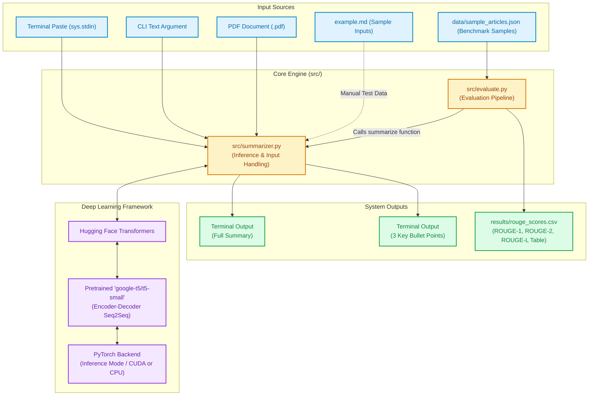

---

## 2. Main Execution & Inference Flow (`src/summarizer.py`)

This flowchart details how `src/summarizer.py` starts, handles various input types, performs chunking for long documents, invokes model inference, and formats the output.

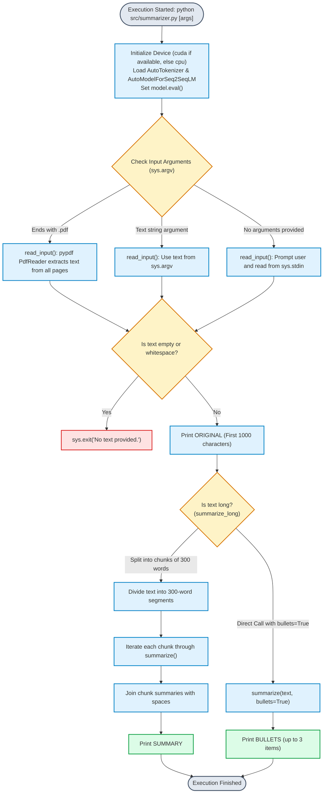

---

## 3. Deep Learning Summarization Pipeline (`summarize()` function)

The internal processing inside `summarize()` converts raw text into deep learning representations, runs Seq2Seq generation with beam search, and decodes the predictions.

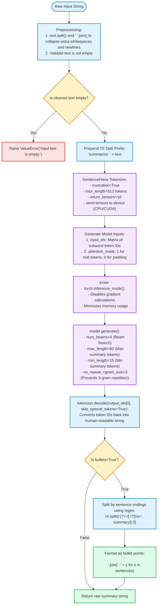

---

## 4. T5-Small Transformer Architecture & Generation Mechanics

This diagram shows what happens inside the `google-t5/t5-small` model during inference: the interaction between the 6-layer Encoder and the 6-layer Decoder with Beam Search.

```mermaid
flowchart LR
    classDef encStyle fill:#dbeafe,stroke:#1d4ed8,stroke-width:2px;
    classDef decStyle fill:#fef3c7,stroke:#b45309,stroke-width:2px;
    classDef searchStyle fill:#f3e8ff,stroke:#7e22ce,stroke-width:2px;
    classDef dataStyle fill:#f1f5f9,stroke:#475569,stroke-width:1.5px;

    subgraph EncoderSide ["T5 Encoder (6 Blocks)"]
        direction TB
        E_In["Token IDs + Positional Encodings"]:::dataStyle
        E_Attn["Bidirectional Self-Attention<br/>(Tokens attend to all tokens)"]:::encStyle
        E_FFN["Feed-Forward Dense Layers + LayerNorm"]:::encStyle
        E_Out["Encoder Hidden States (Context Representation)"]:::encStyle
        E_In --> E_Attn --> E_FFN --> E_Out
    end

    subgraph CrossAttention ["Seq2Seq Bridge"]
        E_Out -->|"Encoder Key & Value Vectors"| D_Cross
    end

    subgraph DecoderSide ["T5 Decoder (6 Blocks)"]
        direction TB
        D_In["Target Token Prefix (Start Token)"]:::dataStyle
        D_Self["Masked Autoregressive Self-Attention<br/>(Tokens only attend to past tokens)"]:::decStyle
        D_Cross["Cross-Attention Layer<br/>(Attends to Encoder Hidden States)"]:::decStyle
        D_FFN["Feed-Forward Dense Layers + LayerNorm"]:::decStyle
        D_LM["LM Head (Linear Projection to Vocab Size 32,128)"]:::decStyle
        D_In --> D_Self --> D_Cross --> D_FFN --> D_LM
    end

    subgraph BeamSearchModule ["Decoding Strategy (Beam Search: num_beams=4)"]
        direction TB
        B_Cand["Select Top-4 Candidate Sequences by Log-Likelihood"]:::searchStyle
        B_Ngram["Apply no_repeat_ngram_size=3 Filter<br/>(Zero out logits of repeated 3-grams)"]:::searchStyle
        B_Term{"Check Terminus:<br/>Token = &lt;/s&gt; OR Length &gt;= 60?"}:::searchStyle
        D_LM --> B_Cand --> B_Ngram --> B_Term
        B_Term -->|"No and Length &lt; 60"| D_In
        B_Term -->|"Yes or Finished"| BestBeam["Return Highest Scoring Sequence"]:::searchStyle
    end
```

---

## 5. Evaluation & ROUGE Benchmarking Flow (`src/evaluate.py`)

This flowchart outlines the quantitative evaluation workflow that validates summary accuracy against human reference summaries.

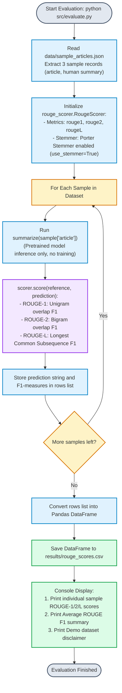

---

## 6. Data Representation & Tensor Transformation Lifecycle

This state transition flowchart tracks the exact transformation of data types and tensor shapes as an article travels through the system.

```mermaid
flowchart LR
    classDef dataBox fill:#ffffff,stroke:#334155,stroke-width:1.5px;
    classDef tensorBox fill:#ede9fe,stroke:#7c3aed,stroke-width:2px;

    T1["Raw Input<br/><b>Type:</b> str / PDF stream<br/><b>Content:</b> 'Solar power capacity...'"]:::dataBox
    --> T2["Cleaned & Prefixed String<br/><b>Type:</b> str<br/><b>Content:</b> 'summarize: Solar power...'"]:::dataBox
    --> T3["Tokenized Tensors<br/><b>Type:</b> torch.Tensor<br/><b>Shape:</b> [1, input_len &lt;= 512]<br/><b>Tensors:</b> input_ids, attention_mask"]:::tensorBox
    --> T4["Encoder Hidden States<br/><b>Type:</b> torch.FloatTensor<br/><b>Shape:</b> [1, input_len, 512]"]:::tensorBox
    --> T5["Generated Output IDs<br/><b>Type:</b> torch.LongTensor<br/><b>Shape:</b> [1, output_len &lt;= 60]"]:::tensorBox
    --> T6["Decoded Text<br/><b>Type:</b> str<br/><b>Content:</b> 'solar power capacity has grown...'"]:::dataBox
    --> T7["Output Formatting<br/><b>Type:</b> str / List[str] / CSV<br/><b>Outputs:</b> summary, bullets, rouge_scores.csv"]:::dataBox
```

---

## 7. File Mapping & Technical Responsibility Matrix

| File Path | Primary Function | Input | Output | Dependencies |
| :--- | :--- | :--- | :--- | :--- |
| `src/summarizer.py` | Model loading, text/PDF ingestion, tokenization, beam search inference, bullet formatting. | Stdin, CLI string, or `.pdf` file path | Terminal summary text & 3 bullet points | `torch`, `transformers`, `pypdf` |
| `src/evaluate.py` | Benchmark evaluation loop, ROUGE metric calculation, results tabulation. | `data/sample_articles.json` | Console scores & `results/rouge_scores.csv` | `pandas`, `rouge-score`, `src/summarizer.py` |
| `data/sample_articles.json` | Ground-truth reference dataset containing 3 real-world test cases. | JSON text file | Articles and reference summaries for evaluation | Standard library `json` |
| `results/rouge_scores.csv` | Output metric storage for evaluation results. | Pandas DataFrame output from `evaluate.py` | CSV file with columns: `prediction`, `rouge1`, `rouge2`, `rougeL` | `pandas` |
| `example.md` | Playground / test paragraphs (Technology, Education, Sports) for testing CLI manual inputs. | Markdown text | Copy-paste input for manual testing | None |
| `viva.md` | Oral exam preparation documentation covering concepts, limitations, and Q&A. | Markdown text | Study guide | None |
| `ppt.md` | Presentation design guidelines and 6-slide script for DL project demonstration. | Markdown text | Presentation blueprint | None |

---

## 8. Runtime Sequence Diagram: Summarization Flow

This sequence diagram depicts the chronological message and control flow between components when executing `src/summarizer.py`.

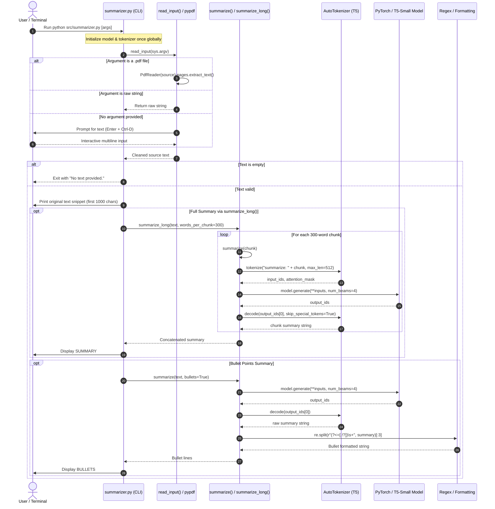

---

## 9. Runtime Sequence Diagram: Evaluation Pipeline

This sequence diagram details the interaction during benchmark evaluation in `src/evaluate.py`.

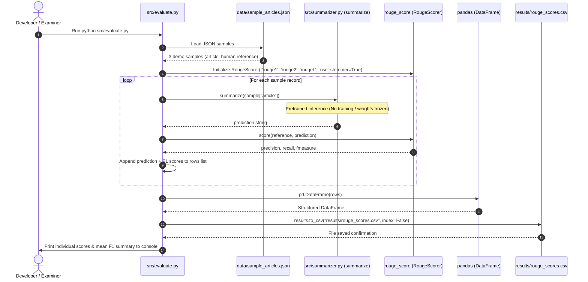

---

## 10. Edge Case & Error Handling Decision Tree

This diagram outlines how the codebase handles various failure modes and edge cases gracefully.

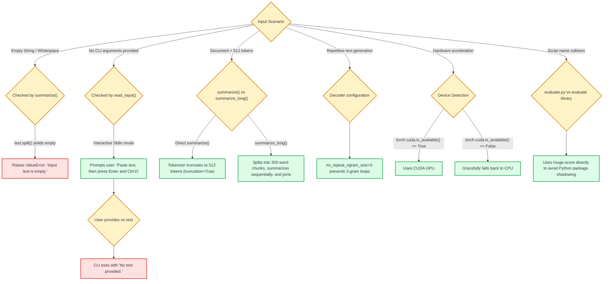

---

## 11. Concrete Example Trace (Solar Power Sample)

An authentic trace from `data/sample_articles.json` through the system into `results/rouge_scores.csv`:

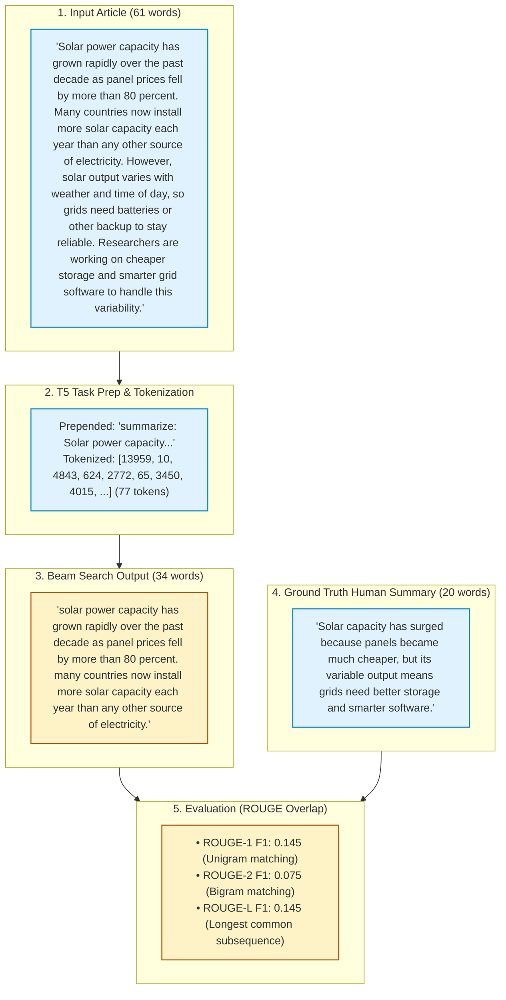

---

## 12. Viva / Defense Quick Reference Guide

Use this chart when explaining the system during oral examination or code defense:

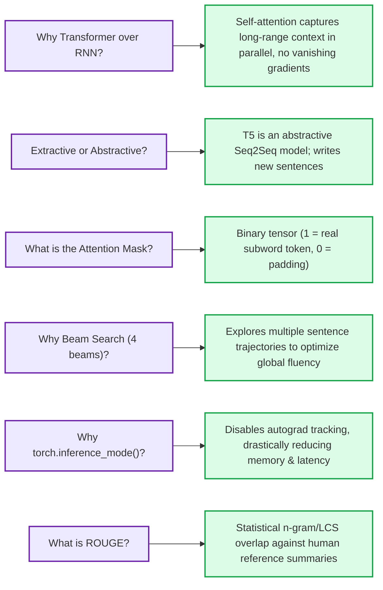


